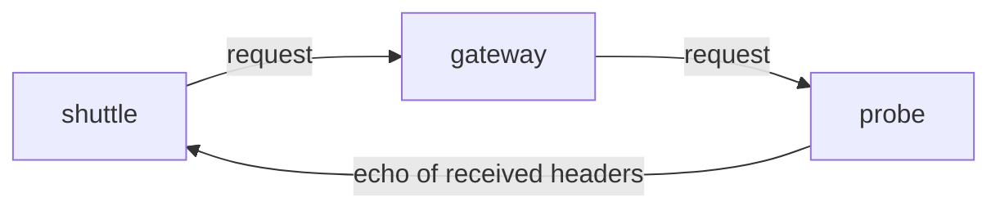

# Finding Where The Context Stops

When a trace is cut in two, the trace view shows only the result: a second trace that starts at a service in the middle of the request path. It does not show which hop removed the header. This part gives a repeatable method that finds the hop with ordinary HTTP requests, and then looks at the most common cause, a proxy that is configured to hide the headers.

## The method: ask each hop what it received

Tracing tools show what services recorded. To find where a header disappears, ask what each hop received. You need an endpoint that returns the request headers it saw. The example `probe` Service in the `starfleet` namespace does this: a request to `/headers` returns the headers of that request as JSON.

The method has four steps:

1. Choose a known `traceparent` value and write it down. In this module the value is `00-0af7651916cd43dd8448eb211c80319c-b7ad6b7169203331-01`.
2. Send a request with that header to the last hop in the chain, directly. The header must appear in the answer. This shows that the last hop does not remove it.
3. Send the same request to the hop before it, and so on towards the entry point.
4. The first hop for which the header is missing in the answer is the hop that removes it, or the hop before it does not forward it.

The test uses a fixed trace-id, so you can recognise it in the answer without reading the whole header list.



The diagram shows a request that enters the `gateway` proxy and ends at the `probe`. The echo from the `probe` tells you what the `gateway` forwarded.

## Run the test in the playground

The `shuttle` pod in the `starfleet` namespace has `curl`. The commands below run `curl` inside that pod.

<!-- astrona:playground:renew -->

First ask the `probe` directly. This shows what a correct request looks like:

```sh
kubectl -n starfleet exec deploy/shuttle -- curl -s http://probe.starfleet/headers -H 'traceparent: 00-0af7651916cd43dd8448eb211c80319c-b7ad6b7169203331-01'
```

The answer lists the request headers. It contains a `Traceparent` entry with the trace-id `0af7651916cd43dd8448eb211c80319c`. The `probe` formats header names with a capital letter at the start. The case change is done by the `probe`, not by your request.

Now send the same request through the `gateway`:

```sh
kubectl -n starfleet exec deploy/shuttle -- curl -s http://gateway.starfleet/headers -H 'traceparent: 00-0af7651916cd43dd8448eb211c80319c-b7ad6b7169203331-01'
```

If the answer has no `Traceparent` entry, the `gateway` removes the header. The direct request proved that the `probe` receives and reports it, so the fault is between the `shuttle` and the `probe`, and the only component there is the `gateway`.

## Why a proxy removes a header

A reverse proxy is a server that accepts a request and sends a new request to another server. It builds the second request itself. Which headers it copies is a setting.

The proxy in this example is nginx. nginx copies all client request headers to the upstream by default, with two exceptions that the nginx documentation lists: header fields with an empty value are not passed on, and header fields whose name contains underscores are dropped unless a directive allows them. The directive `proxy_set_header` changes this:

```
location / {
  proxy_pass http://probe.starfleet.svc.cluster.local:80;
  proxy_set_header Host $host;
  proxy_set_header traceparent "";
  proxy_set_header tracestate "";
}
```

A `proxy_set_header` line with an empty string sets the header value to empty. Because nginx does not pass on an empty header, the effect is that the header is removed. Teams add such lines on purpose, for example to stop untrusted callers from starting traces inside the network. The same lines applied to every caller also remove the headers of trusted callers, which breaks every trace that crosses the proxy.

Other proxies and gateways have their own settings with the same effect:

- A rule that lists allowed headers and forwards only those. Any header not on the list, including `traceparent`, is dropped.
- A web application firewall rule that removes headers it does not know.
- A request transformation that builds a new set of headers from a template.
- A service mesh sidecar that is configured with a different propagation format.

When you find the hop, read its configuration for any rule that names a header or lists headers. Do not stop at the first match: a proxy can remove `traceparent` in one place and `tracestate` in another, and fixing only one leaves the other fault.

## Fix the configuration and apply it

nginx reads its configuration when the process starts. A change to the ConfigMap that holds the configuration does not change the running process. After editing, restart the Deployment so that new pods start with the new file:

```sh
kubectl -n starfleet rollout restart deployment/gateway
kubectl -n starfleet rollout status deployment/gateway
```

Then repeat the request through the `gateway`. The answer should now have the `Traceparent` entry with the same trace-id. Run a second request with a `tracestate` header too, because the two headers can be removed by different lines.

## Other places where context is lost

The same method works for faults that are not proxies. The method of asking each hop still finds the first hop where the data is missing; only the reason changes.

- **Message queues and background jobs.** There is no HTTP request. The producer must copy the span context into the message headers or properties, and the consumer must extract it. A producer that does not inject starts every consumer span as a new root.
- **Thread and task boundaries.** In-process context lives in a context object that is bound to the current thread or task. Work that is handed to a pool or an event loop without carrying the context starts with an empty one.
- **Clients that build requests by hand.** A service that creates its own HTTP client and does not use the instrumented client sends no header.
- **Redirects.** Some clients do not copy custom headers to the redirect target.
- **Format mismatch.** The sender writes `b3` and the receiver extracts `tracecontext`.

For each cause the test is the same: find the first hop that does not see the header, then read what runs at that hop.

## Checkpoints

- You send a request with `traceparent` to a proxy and the echo has no `Traceparent`. A direct request to the upstream shows it. Which component removes the header?
- A fix is saved in the ConfigMap. The echo still shows no header. What did you forget?
- The echo shows `Traceparent` but not `Tracestate`. Is the proxy fixed?

Answers: the proxy, because the direct request proves the upstream reports it. The proxy process must restart to read the new file. No: the two headers are separate, and each needs a request that proves it.

You can now find the hop that removes the context with ordinary requests, and you know the proxy settings that cause it. The remaining question for the headers that carry application data is whether a hop should forward them at all.

## Common pitfalls

> [!WARNING]
> - Do not test only through the entry point. If the header is missing at the end, you do not yet know which hop removed it.
> - Do not change the ConfigMap and stop there. A proxy that read its file at start keeps the old rules until it restarts.
> - Do not remove all `proxy_set_header` lines to fix a header problem. The `Host` line may be needed for the upstream to route the request.
> - Do not send only `traceparent` in the test. A removed `tracestate` stays hidden.
