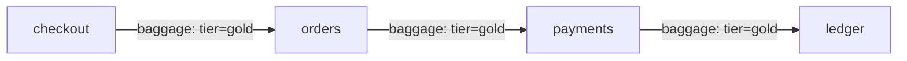

# Baggage And How It Travels

Trace context answers one question: which trace does this request belong to? Sometimes a service needs more. A checkout service knows the customer tier, and a service four hops later wants to use it without calling the checkout service again. Baggage is the mechanism that carries such key-value pairs along the request path. This part explains how baggage is written, how it travels and what it does not do.

## What baggage is

Baggage is a set of name-value pairs that is propagated with the request, next to the span context. It is part of the OpenTelemetry context, not part of a span. A span has attributes, and baggage is a separate structure. Setting a baggage entry does not add an attribute to any span, and adding a span attribute does not put anything into baggage.

The W3C Baggage standard defines the HTTP header `baggage`:

```
baggage: userId=alice,tier=gold;source=checkout
```

The header has these parts:

- A list of members separated by commas.
- Each member is `key=value`. The value is percent-encoded when it contains special characters.
- A member can have properties after a semicolon, for example `;source=checkout`. A property is metadata about the entry.

The standard sets minimum limits that a platform must support: at least 64 list members, at least 8192 bytes for the whole header and at least 4096 bytes for one member. A platform may drop members that exceed a limit.

## How baggage travels

Baggage uses the same injector and extractor design as trace context. With the default `OTEL_PROPAGATORS=tracecontext,baggage`, an instrumented HTTP client writes both `traceparent` and `baggage` to an outgoing request, and an instrumented server reads both from an incoming request.

The flow inside one service:

1. The extractor reads the `baggage` header and stores the members in the current context.
2. Application code can read a member through the Baggage API, for example to choose a code path.
3. The service makes an outgoing call. The injector copies the current baggage into the request headers.
4. The next service repeats the steps.



The diagram shows one entry that every service forwards. Each service can read the entry, and none of them needs to call the service that created it.

## Baggage is not a span attribute

A frequent mistake is to expect baggage entries to appear in the trace view. They do not. Three facts explain it:

- The tracing SDK exports spans. Spans contain attributes that code set on the span.
- Baggage lives in the context. The SDK does not copy it to spans.
- To see a baggage member in a trace, code must read the member and set it as a span attribute, or a component such as a span processor must be configured to copy chosen keys.

This means baggage is invisible in telemetry unless someone makes it visible. To test whether baggage arrives, look at the request headers that a service receives. That is the reason the exercises in this module use an endpoint that echoes headers.

## What baggage is used for

Typical uses are small, stable values that many services need:

- A tenant or customer tier, to choose a rate limit or a routing path.
- A feature flag variant, so that all services in a request use the same variant.
- A request origin, for example `source=mobile`, to add as an attribute to every span for filtering.

Baggage does not suit the following:

- Large data. Every request on every hop carries it. A 4 KiB header on each call adds up.
- Secrets. The header travels in clear text to every service called, including services of other organizations.
- Data that must stay consistent. A downstream service can change or remove entries, and nothing prevents it.

## Who can change baggage

Any service in the path can read, add, change or remove entries. Baggage has no signature and no owner. A service that sets `tier=gold` cannot prevent a later service from setting `tier=basic`. The receiver of baggage has to treat it as input, not as a fact.

Changes are visible only by their effect downstream. A service that adds an entry puts it in the headers of its outgoing requests. A service that drops an entry omits it. Neither action is logged by default.

## Failure patterns

Baggage breaks in different ways than trace context:

- **A proxy removes the header.** The same cause as for `traceparent`: a rule that sets `baggage` to empty. The trace still looks complete, because baggage is not part of the trace. Only the code that needed the entry notices.
- **The propagator list does not include baggage.** `OTEL_PROPAGATORS=tracecontext` propagates trace context only. The entry is read in the first service and never forwarded.
- **The header exceeds a limit.** A member is dropped or the whole header is ignored, depending on the platform. Which entry is lost depends on its position in the list.
- **A value is not encoded.** A comma or a semicolon inside a value splits it into several members.

## Checkpoints

- A service sets a baggage entry `tier=gold`. Does a span of that service have an attribute `tier`?
- `OTEL_PROPAGATORS=tracecontext` is set on a service. It receives `baggage` and calls another service. Does the second service receive the entry?
- Name two reasons not to put an access token in baggage.

Answers: no, baggage is separate from span attributes. No, because the baggage propagator is not listed, so nothing writes the header. The header travels in clear text to every service in the path, and any service can read it.

You now know that baggage is a separate, unauthenticated key-value set that travels with the request. The next question is what should happen to such data when the request comes from a caller you do not control.

## Common pitfalls

> [!WARNING]
> - Do not look for baggage entries in a trace view. They are not on spans unless code copies them.
> - Do not put personal data or secrets in baggage. Every downstream service receives it.
> - Do not trust a baggage value for authorization. Any service on the path can change it.
> - Do not forget to encode values that contain commas, semicolons or equal signs.
