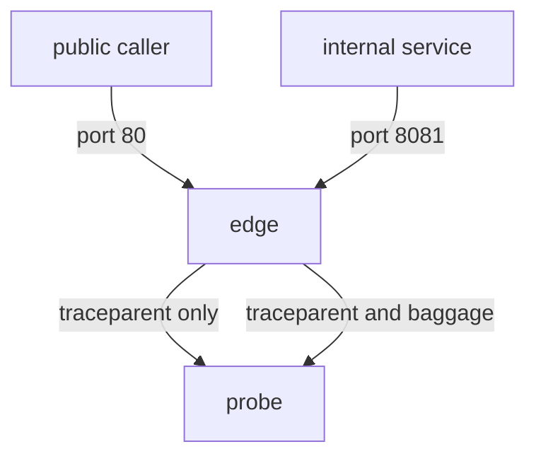

# Untrusted Context At The Edge

A request that arrives from the internet carries headers that the caller chose. Some of those headers are `traceparent`, `tracestate` and `baggage`. If the edge forwards them unchanged, the caller controls part of what your internal services see. This part explains the trust boundary, what a caller can do with each header and how to remove baggage at the public edge while internal traffic keeps it.

## The trust boundary

A trust boundary is the point where traffic moves from a source you do not control to a source you do. The edge proxy of a public service sits on that boundary. Callers on one side are unknown. Services on the other side are yours.

Inside the boundary, forwarding context unchanged is the goal: it keeps traces whole and passes baggage. At the boundary, each header needs a decision. The decision depends on what a caller can do with the header.

## What a caller can do with each header

**With `baggage`.** A caller can send any members. A downstream service that reads `tier=gold` from baggage and gives better limits to gold customers now trusts a value that the caller wrote. A caller can also send many large members. Every internal hop copies them to its own outgoing calls, so the cost grows with the length of the request path. A caller can also send names that collide with internal names and replace an internal value if the services merge baggage by overwriting.

**With `traceparent`.** A caller can send a trace-id and the sampled flag. The effects are smaller but real:

- A caller that sends the flag `01` asks internal services to record the trace. If sampling is parent-based, a caller can raise the number of recorded traces.
- A caller that sends a known trace-id can attach its requests to a trace in your system, or send the same trace-id on many requests so that unrelated work appears as one trace.
- A caller that sends the flag `00` can hide its requests from sampling.

Some organizations accept `traceparent` from partners they trust and drop it from everyone else. Others accept it everywhere and rely on sampling limits. Both are decisions, and both need to be written down. This part focuses on `baggage` because the right action is clear: public callers should not be able to write it.

**With `tracestate`.** The risk is the same as for baggage but the volume is limited to 32 members, and vendors read their own members only.

## Two listeners, two policies

The example `edge` proxy in the `starfleet` namespace has two listeners:

- Port 80 is the public listener. Callers from outside the organization use it.
- Port 8081 is the internal listener. Only services of the organization use it.

Both forward to the `probe` Service. The nginx configuration has two `server` blocks, one for each port. A `proxy_set_header` rule inside a `server` block applies only to that listener, so each listener can have its own policy:

```
server {
  listen 80;
  location / {
    proxy_pass http://probe.starfleet.svc.cluster.local:80;
    proxy_set_header Host $host;
    proxy_set_header baggage "";
  }
}
server {
  listen 8081;
  location / {
    proxy_pass http://probe.starfleet.svc.cluster.local:80;
    proxy_set_header Host $host;
  }
}
```

The first block removes `baggage` and forwards everything else, including `traceparent`. The second block forwards all headers. A header with an empty value is not passed on by nginx, so the empty `baggage` rule removes the header.



The diagram shows that both listeners reach the same upstream. The difference is in the headers that each listener passes.

## Test both listeners

The commands below run `curl` in the `shuttle` pod. Each sends `traceparent` and `baggage`, and the `probe` answers with the headers it received.

<!-- astrona:playground:renew -->

Send the request to the public listener:

```sh
kubectl -n starfleet exec deploy/shuttle -- curl -s http://edge.starfleet/headers -H 'traceparent: 00-0af7651916cd43dd8448eb211c80319c-b7ad6b7169203331-01' -H 'baggage: userId=alice'
```

Then to the internal listener:

```sh
kubectl -n starfleet exec deploy/shuttle -- curl -s http://edge.starfleet:8081/headers -H 'traceparent: 00-0af7651916cd43dd8448eb211c80319c-b7ad6b7169203331-01' -H 'baggage: userId=alice'
```

A correct setup shows `Traceparent` in both answers, `Baggage` only in the answer from port 8081. If the public answer still contains `Baggage` with `userId=alice`, the public `server` block has no rule for it.

To change the public listener, edit the ConfigMap `edge-conf` and add the line `proxy_set_header baggage "";` to the block with `listen 80;`. Then restart the Deployment so that nginx reads the file:

```sh
kubectl -n starfleet rollout restart deployment/edge
kubectl -n starfleet rollout status deployment/edge
```

Run both requests again and compare the answers with the expected result above.

## Writing the policy down

A header policy at the edge is only useful when it can be checked. Write it as a table that names each header and each listener:

| Header | Public listener | Internal listener |
| --- | --- | --- |
| `traceparent` | forward | forward |
| `tracestate` | forward | forward |
| `baggage` | remove | forward |

Then test each cell with a request. The test for a "remove" cell sends the header with a value you can recognise in the answer, for example `userId=alice`, and checks that the value does not appear. The test for a "forward" cell checks that it does. A policy with only "remove" tests can pass when the proxy is broken and forwards nothing at all.

## Other ways to apply the same policy

- Remove the header at the load balancer or API gateway that terminates public traffic, so that the proxy inside the cluster never sees it.
- Let an instrumented gateway extract the incoming context and start a new trace linked to it, instead of continuing the caller's trace. The gateway then writes its own `traceparent` downstream.
- Allow only chosen baggage keys. A processor or gateway rule that keeps `tier` and drops everything else limits the size and the names.

## Checkpoints

- The public listener forwards `baggage: tier=gold` from an unknown caller. What can go wrong downstream?
- A rule is added to the block for port 8081 by mistake. What does the internal test show?
- Why does a check that only confirms the absence of `baggage` on the public listener not prove a working proxy?

Answers: a service can give gold treatment based on a value the caller wrote. Internal callers lose baggage, so the internal check for `baggage` fails. A proxy that returns an error or forwards nothing also shows no `baggage`; the same request must also show `traceparent`.

You can now decide per header and per listener what crosses a trust boundary, write the policy as a table and prove each cell with a request.

## Common pitfalls

> [!WARNING]
> - Do not add a header rule at the `http` level when only one listener needs it. It applies to every listener below it.
> - Do not check only that `baggage` is gone. Check that `traceparent` still arrives.
> - Do not forget to restart the proxy after a configuration change.
> - Do not treat the internal listener as safe forever. A service that forwards public input to internal callers moves the risk inside.
