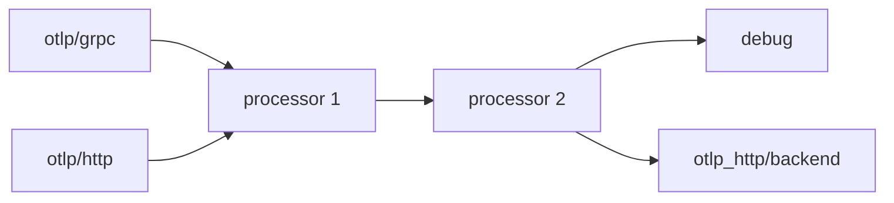

# How A Collector Builds Pipelines

An application exports spans and gets a connection error. The Collector pod is running, its Service exists and its configuration file has an OTLP/HTTP receiver. Yet nothing listens on port 4318. To debug this, you need to know exactly which parts of a Collector configuration start a component and which parts only describe one. This part explains how the OpenTelemetry Collector turns a configuration file into running pipelines.

## What the Collector is

The OpenTelemetry Collector is a process that receives telemetry, changes it and sends it on. It supports three signals: traces, metrics and logs. Its job in a system is to sit between applications and a backend, so that applications send data once and the Collector handles batching, retries, filtering and delivery to one or more backends.

The `contrib` distribution used in this course, `otel/opentelemetry-collector-contrib`, includes a large set of community components. A distribution is a build of the Collector that includes a chosen set of components. A component that is not in the build cannot be used, and the Collector fails at start when the configuration names it.

## The sections of a configuration

The configuration is one YAML document with these top-level sections:

| Section | Purpose |
| --- | --- |
| `receivers` | Components that accept data, for example from applications. |
| `processors` | Components that inspect or change data in transit. |
| `exporters` | Components that send data to a destination. |
| `connectors` | Components that act as an exporter in one pipeline and a receiver in another. |
| `extensions` | Components that add functions that do not handle telemetry, such as a health check. |
| `service` | Selects which components run and how they are connected. |

Each component has an identifier of the form `type` or `type/name`. The type selects the implementation, and the optional name allows several instances of the same type. `otlp/grpc` and `otlp/http` are two instances of the `otlp` receiver type.

## Defined is not enabled

The sections `receivers`, `processors`, `exporters`, `connectors` and `extensions` only define components and their settings. Nothing in them starts a component. The `service` section decides:

- `service.pipelines.<name>` lists the receivers, processors and exporters of each pipeline.
- `service.extensions` lists the extensions that start.

A component that is defined but not listed is never created. The Collector does not report an error for it, because defining a component that is not in use is allowed. The result is silent: the configuration is valid and the component does not run.

Look at this configuration:

```yaml
receivers:
  otlp/grpc:
    protocols:
      grpc:
        endpoint: 0.0.0.0:4317
  otlp/http:
    protocols:
      http:
        endpoint: 0.0.0.0:4318
exporters:
  debug:
    verbosity: detailed
service:
  pipelines:
    traces:
      receivers: [otlp/grpc]
      exporters: [debug]
```

The receiver `otlp/http` is defined with an endpoint, but the `traces` pipeline lists only `otlp/grpc`. No process listens on port 4318. A client that sends data to that port gets a refused connection, not an error from the Collector.

The same rule applies to a processor and an extension. A `filter` processor that is defined but not listed in the pipeline filters nothing. A `health_check` extension that is defined but not listed in `service.extensions` opens no port.

## How a pipeline is built

A pipeline connects receivers to exporters through processors. The rules:

- A pipeline has at least one receiver and at least one exporter. Processors are optional.
- Data from all receivers of a pipeline goes to the first processor. If there are several receivers, their data is merged.
- Processors run in the order they are listed. The output of one is the input of the next.
- The output of the last processor goes to every exporter of the pipeline. The data is copied for each exporter, so one exporter that is slow or failing does not change what another exporter receives.
- A pipeline handles one signal. A receiver that supports several signals needs a pipeline for each signal it should serve.



The diagram shows two receivers that feed one chain of two processors and two exporters. A fault in one place affects everything after it and nothing before it.

One receiver can appear in several pipelines. The receiver then sends a copy of each item to each pipeline. A processor listed in two pipelines runs as a separate instance in each, with its own state.

## Where each stage is configured

When you debug a pipeline, it helps to know which section holds which kind of fault:

- A client cannot connect: look at the `receivers` section for the endpoint and at the pipeline for the receiver.
- Data arrives but never reaches the backend: look at the processors in order, then at the exporter.
- The Collector does not start: the configuration names a component that does not exist, or a setting that does not fit the component. The error is in the Collector log at start.

## Validate before you deploy

The Collector binary has a `validate` subcommand that loads a configuration and checks it without starting the pipelines. It finds unknown component types, unknown settings and pipelines that reference components that do not exist. It does not find a component that is defined and unused, because that is valid.

A review habit follows from this. List every component under `receivers`, `processors`, `exporters` and `extensions`, then check that each one appears in `service`. A component that appears in only one place is a candidate for a fault.

## Checkpoints

- A configuration defines `otlp/grpc` and `otlp/http`, and a pipeline lists only `otlp/grpc`. Which ports does the Collector open for OTLP?
- A `health_check` extension is defined and `service.extensions` is empty. What does a request to port 13133 return?
- Why does `validate` pass for a configuration with an unused receiver?

Answers: only the gRPC port, 4317. The connection is refused, because the extension never starts. An unused component is allowed, so there is nothing to reject.

You now know that the `service` section, and not the component sections, decides what runs. What remains is how to confirm, from the outside and from the Collector itself, which components are actually running.

## Common pitfalls

> [!WARNING]
> - Do not read the `receivers` section as a list of what runs. Read the pipelines.
> - Do not expect an error for an unused component. The configuration is valid.
> - Do not change processor order without thinking about what each processor sees. Each processor receives the output of the one before it.
> - Do not assume a configuration change takes effect while the Collector runs. The Collector reads its file at start.
