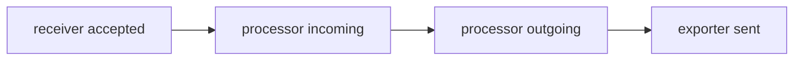

# Counting Items Between Stages

Applications export without errors, the receiver accepts the requests, and the backend still shows less data than expected, or none. The data left the application and entered the Collector, so the loss happens somewhere inside. This part shows how to use the Collector's own counters to find the stage where items disappear, using nothing but subtraction.

## Every stage counts what it handles

Each component in a pipeline reports how many items it handled. An item is one span, one metric data point or one log record, depending on the pipeline. The counters are named after the stage and the signal:

| Stage | Counter | Meaning |
| --- | --- | --- |
| Receiver | `otelcol_receiver_accepted_spans` | Spans accepted and passed to the next stage. |
| Receiver | `otelcol_receiver_refused_spans` | Spans refused, with an error returned to the sender. |
| Processor | `otelcol_processor_incoming_items` | Items that entered a processor. |
| Processor | `otelcol_processor_outgoing_items` | Items that left a processor. |
| Exporter | `otelcol_exporter_sent_spans` | Spans sent to the destination. |
| Exporter | `otelcol_exporter_send_failed_spans` | Spans the exporter could not send. |
| Exporter | `otelcol_exporter_enqueue_failed_spans` | Spans the exporter could not place in its queue. |

Metric names and which counters exist depend on the Collector version, and counters can carry a `_total` suffix. The Collector documentation lists the metrics of each release. In a version without processor counters, the relation between receiver and exporter counters still shows a loss, but not which processor caused it.

Each line of the output has labels. The label that names the component, for example `receiver="otlp/http"` or `exporter="otlp_http/backend"`, lets you read one component when a pipeline has several.

## The conservation rule

In a pipeline without sampling, the items that leave one stage must arrive at the next. If the stages are numbered from receiver to exporter, the rule is:

```
accepted at the receiver
  = outgoing from each processor in turn
  = sent plus failed plus still queued at the exporter
```

When two neighbouring numbers differ, the difference was removed between them. The location of the difference is the location of the fault:

- Accepted is higher than the first processor's incoming count: items are lost between receiver and processor. This is rare; check for several pipelines sharing the receiver.
- A processor's outgoing count is lower than its incoming count: that processor removes items. A filter, a sampler or an error in a statement can do this.
- Exporter sent is lower than the last processor's outgoing count: the exporter fails, queues or drops.



The diagram shows the four numbers to compare in order. A drop between two boxes marks the stage that removed items.

Two processors can legitimately change counts. A batch processor groups items but keeps the item count. A sampler drops items on purpose. A rule that removes spans by name is also on purpose, but the condition may be wrong.

## Read the counters in the playground

The playground starts a Collector with a `filter/health` processor that has a faulty condition. Spans are accepted, and none arrive at the `debug` exporter.

<!-- astrona:playground:renew -->

Send two spans with different names. The first is the one you want to keep:

```sh
kubectl -n starfleet exec deploy/shuttle -- curl -s -o /dev/null -w '%{http_code}\n' -X POST -H 'Content-Type: application/json' -d '{"resourceSpans":[{"resource":{},"scopeSpans":[{"scope":{},"spans":[{"traceId":"5b8efff798038103d269b633813fc60c","spanId":"eee19b7ec3c1b174","name":"POST /checkout","kind":2,"startTimeUnixNano":"1700000000000000000","endTimeUnixNano":"1700000001000000000"}]}]}]}' http://otelcol.observability:4318/v1/traces
```

Then read the counters. The `grep` keeps only the lines that matter:

```sh
kubectl -n starfleet exec deploy/shuttle -- curl -s http://otelcol.observability:8888/metrics | grep -E 'otelcol_(receiver_accepted_spans|processor_incoming_items|processor_outgoing_items|exporter_sent_spans)'
```

Compare the numbers. If the receiver counter increased by one and the processor outgoing counter did not, the processor removed the span. The `debug` exporter output in the Collector log confirms it: the trace ID of the span is not there.

If your version has no processor counters, use the log: the span is missing from the `debug` output although the receiver counted it.

## When the fault is in the middle of a chain

A pipeline with several processors needs one comparison per processor. Add the labels to the search so that each processor appears on its own line, then read down the list in pipeline order. The first processor whose outgoing count is lower than its incoming count is the first stage that removes items.

For several pipelines that share a receiver, a counter at the receiver is the sum for all pipelines. Compare it with each pipeline's own counters, not with the total.

## What counters cannot tell

Counters show how many, not which. To find which items disappear, send an item you can identify, as in the example, and look for it in the output. The counter says where, the identified item says why: the name of the span or the value of an attribute is what the condition matched.

Counters also depend on time. A counter is cumulative since the process started, so compare values before and after a test, not a single reading.

## Checkpoints

- Accepted is 10, a processor's incoming is 10 and its outgoing is 3. Which stage removes data?
- The exporter's sent count is lower than the last processor's outgoing count by 7 and the send-failed count is 7. What does that point at?
- Why compare two readings instead of one?

Answers: that processor. The exporter, which failed to send those items to the destination. A counter is cumulative since the process started.

You can now find the stage that loses items by subtraction. The remaining task is to understand why a processor removes items and how to fix the rule that does it.

## Common pitfalls

> [!WARNING]
> - Do not compare counters of different signals. Spans, metrics and logs have separate counters.
> - Do not read a single value. Take one reading before the test and one after.
> - Do not assume a lower exporter count means the backend is down. A processor before it can remove items.
> - Do not forget a restart resets counters to zero.
