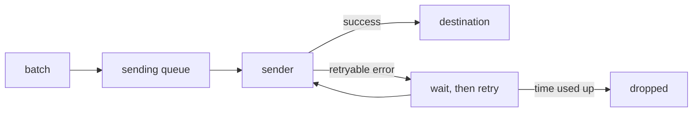

# What Happens When An Export Fails

A backend restarts for a minute and the Collector keeps receiving spans. Whether those spans arrive later or are lost depends on three exporter settings. This part follows one batch of spans from the moment the exporter cannot reach its destination, and explains what each setting does with it.

## The path of a batch inside an exporter

An exporter does not send each span as it arrives. A batch processor in front of it groups spans, and the exporter receives groups. Inside the exporter a batch goes through these steps:

1. The batch enters the exporter. If a sending queue is enabled, the batch is placed in the queue. If it is not, the calling thread sends the batch directly.
2. A sender takes the batch from the queue and calls the destination.
3. If the call succeeds, the batch is done.
4. If the call fails with an error that can be retried, the retry logic waits and sends the batch again.
5. If the retries are used up, or the error cannot be retried, the batch is dropped and the Collector counts the spans as failed.



The diagram shows two places where data waits and one place where it is dropped. The queue holds batches that have not been tried. The retry wait holds batches that failed. A drop happens only when the retry time is used up, or when no queue or retry is configured.

## The three settings

| Setting | What it controls |
| --- | --- |
| `retry_on_failure` | Whether a failed batch is sent again, how long to wait between tries and for how long to keep trying. |
| `sending_queue` | Whether batches wait in memory (or on disk) before being sent, how many fit, and how many senders work at once. |
| `timeout` | How long one call may take before it counts as failed. |

Defaults depend on the exporter and the version. Many exporters that use the shared exporter helper enable retry and a small queue by default, but a configuration can switch them off with `enabled: false`. Never assume the default; read the configuration and the documentation for the version in use.

## Retry in detail

The retry settings have four values:

```
exporters:
  otlp_http/backend:
    endpoint: http://backend.observability:4318
    retry_on_failure:
      enabled: true
      initial_interval: 5s
      max_interval: 30s
      max_elapsed_time: 300s
```

The first wait is `initial_interval`. Each further wait grows, using exponential backoff, up to `max_interval`. After `max_elapsed_time` in total, the batch is dropped. A value of `0` for `max_elapsed_time` is documented in some versions as no limit. Check the documentation of your version, because an unbounded retry holds data in memory.

Which errors are retried depends on the protocol. A connection that is refused, a timeout and a server error such as 503 are retried. An error that says the request itself is wrong, such as 400, is not retried, because sending the same bytes again would fail the same way. The exporter marks these as permanent errors and drops the batch at once.

## The queue in detail

Without a queue, a failure is handled while the caller waits. Upstream components then wait too, and the receiver may answer the sender with an error. With a queue, the receiver gets its answer as soon as the batch is in the queue, and the sender works in the background.

```
sending_queue:
  enabled: true
  num_consumers: 10
  queue_size: 5000
```

The `queue_size` limit counts items of the queue's unit. In the default setting the unit is requests, which means batches, so the number is not a count of spans. Newer versions add a `sizer` setting that can count items or bytes; check which sizer your version uses before you calculate capacity.

When the queue is full, a new batch is refused. The exporter counts it as enqueue failed, and the error returns to the component before it. The data is lost unless that component can retry.

The queue lives in memory. A restart of the Collector loses everything in it. The next part explains how to keep it across restarts.

## Observe the failure in the playground

The playground Collector exports to a `backend` Deployment in the same namespace, with retry and queue switched off. Stop the backend and send a span:

<!-- astrona:playground:renew -->

```sh
kubectl -n observability scale deployment/backend --replicas=0
```

```sh
kubectl -n starfleet exec deploy/shuttle -- curl -s -o /dev/null -w '%{http_code}\n' -X POST -H 'Content-Type: application/json' -d '{"resourceSpans":[{"resource":{},"scopeSpans":[{"scope":{},"spans":[{"traceId":"7c1e5f0a2b3d4c6e8f9a0b1c2d3e4f50","spanId":"1a2b3c4d5e6f7a8b","name":"POST /pay","kind":2,"startTimeUnixNano":"1700000000000000000","endTimeUnixNano":"1700000001000000000"}]}]}]}' http://otelcol.observability:4318/v1/traces
```

Then read the failure counters:

```sh
kubectl -n starfleet exec deploy/shuttle -- curl -s http://otelcol.observability:8888/metrics | grep -E 'otelcol_exporter_(sent|send_failed|enqueue_failed)_spans'
```

With no retry and no queue, the failed counter rises and the span is gone when the backend returns. Start the backend again with `kubectl -n observability scale deployment/backend --replicas=1` and check that the span does not arrive. Then enable retry and queue, restart the Collector, repeat the test, and check that the span arrives after the backend is back.

## Checkpoints

- A batch fails with a 503 and `retry_on_failure` is enabled with `max_elapsed_time: 300s`. When is it dropped?
- A batch fails with a 400. Is it retried?
- `queue_size: 5000` with the default sizer. Does it hold 5000 spans?

Answers: after about 300 seconds of trying. No, a 400 is a permanent error. No, it holds 5000 batches of any size.

You now know the path of a batch and where it waits or is dropped. The next part covers how to size the queue and how to keep it across a restart of the Collector.

## Common pitfalls

> [!WARNING]
> - Do not assume retry and queue are on. Read the configuration; a block with `enabled: false` switches them off.
> - Do not read `queue_size` as a count of spans. It counts the unit of the sizer.
> - Do not expect retry to help with a 400 error. The batch is dropped at once.
> - Do not forget that a restart of the Collector empties an in-memory queue.
