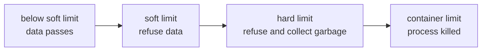

# The Memory Limiter

A Collector that is killed for running out of memory loses everything it holds, and Kubernetes starts it again with an empty state. The `memory_limiter` processor exists to prevent that kill. This part explains how it measures memory, what its two limits mean, and why its position in the processor list decides whether it works.

## What the processor does

The `memory_limiter` checks the memory use of the Collector process at a fixed interval. When the use passes a limit, the processor refuses new data and asks the runtime to free memory. Refusing data is a controlled loss. The alternative is that the operating system kills the process, which loses all data in flight and all queued data.

The processor does not reduce the memory that data already uses. It stops more data from entering until the use falls.

## The settings

```
processors:
  memory_limiter:
    check_interval: 1s
    limit_mib: 200
    spike_limit_mib: 40
```

| Setting | Meaning |
| --- | --- |
| `check_interval` | How often memory use is measured. Documentation recommends 1 second. |
| `limit_mib` | The hard limit in MiB of memory the process may use. |
| `spike_limit_mib` | The expected largest spike between two checks. It defaults to 20 percent of `limit_mib`. |
| `limit_percentage` | The hard limit as a percentage of the total memory the process sees. |
| `spike_limit_percentage` | The spike limit as a percentage of total memory. |

The percentage settings use the memory that the process sees. In a container with a memory limit, newer Go runtimes see the container limit, but verify the behaviour for your version before you rely on a percentage. A value in MiB is predictable.

The two limits create two thresholds:

```
soft limit = limit_mib - spike_limit_mib
hard limit = limit_mib
```

When the use is below the soft limit, data passes. When the use is at or above the soft limit, the processor starts to refuse data. When the use passes the hard limit, the processor also forces garbage collection to free memory. The spike limit is the gap that gives the process room to grow between two checks without crossing the hard limit.



The diagram shows the order of the thresholds. The container limit must be above the hard limit, or the process is killed before the processor can act.

## Choosing the numbers

The Go runtime and the other components need memory that the limiter does not count as data. A common practice is to set `limit_mib` about 80 percent of the container limit, and to leave at least a few tens of MiB of room:

| Container limit | `limit_mib` | `spike_limit_mib` |
| --- | --- | --- |
| 256 MiB | 200 | 40 |
| 512 MiB | 400 | 80 |
| 1024 MiB | 800 | 160 |

The values in the table are a starting point. Measure the process memory under load and adjust.

A limit that is higher than the container limit protects nothing. The process reaches the container limit first and is killed. The same holds for a `limit_mib` that equals the container limit, because the Go runtime and the stacks need memory outside the count.

## The processor must be first

Processors run in the order of the list. The `memory_limiter` refuses data before the other processors handle it. If another processor comes first, it receives and processes data that the limiter should have refused, and its work uses the memory that the limiter was meant to protect.

```
service:
  pipelines:
    traces:
      receivers: [otlp]
      processors: [attributes/env, memory_limiter]
      exporters: [otlp_http/backend]
```

This list is wrong. During a spike, `attributes/env` allocates memory for every span before the limiter can refuse them. The documentation of the processor says to place it first in the pipeline, directly after the receivers. The correct list is:

```
processors: [memory_limiter, attributes/env]
```

The configuration is valid in both orders. The Collector starts, the metrics look normal, and the fault shows up only under a spike, when the container is killed although a limiter is configured.

## Read the configuration in the playground

The playground Collector runs with a 256 MiB container limit. Read its processors list:

<!-- astrona:playground:renew -->

```sh
kubectl -n observability get configmap otelcol-config -o jsonpath='{.data.config\.yaml}'
```

Answer three questions from the output:

1. Which processor is first in the `traces` pipeline?
2. What are `limit_mib` and `spike_limit_mib`, and what is the soft limit?
3. Is the hard limit below the container limit with room to spare?

The container limit is in the Deployment:

```sh
kubectl -n observability get deployment otelcol -o jsonpath='{.spec.template.spec.containers[0].resources.limits.memory}'
```

Compare the two numbers. If the hard limit is at or above the container limit, the limiter cannot act in time.

## Checkpoints

- `limit_mib: 200` and `spike_limit_mib: 40`. At what memory use does the processor start to refuse data?
- The limiter is second in the list. Does it protect the process?
- A container has a 512 MiB limit and `limit_mib: 600`. What happens in a spike?

Answers: 160 MiB. Only partly, because the processor before it handles the data first. The process is killed at 512 MiB, before the hard limit is reached.

You can now read a limiter configuration and judge it against a container limit and a processor order. The next part shows what happens to the senders when the limiter refuses data.

## Common pitfalls

> [!WARNING]
> - Do not place any processor before the `memory_limiter`.
> - Do not set `limit_mib` at or above the container memory limit.
> - Do not set `spike_limit_mib` equal to or above `limit_mib`. The soft limit would be zero or negative.
> - Do not trust a percentage setting without checking which total memory the process sees.
