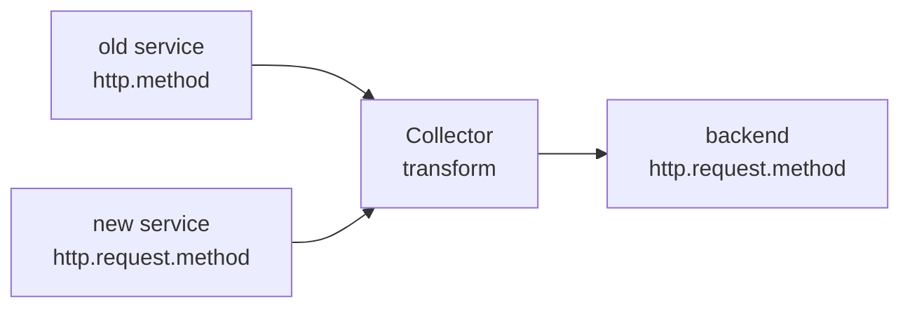

# Semantic Conventions And Attribute Names

A dashboard query asks for the attribute `http.request.method`. Half of the services send `http.method`. The spans arrive and no error appears, but the query returns half of the traffic. This part explains what semantic conventions are, why names change between versions, and how to see which names your data carries.

## What a semantic convention is

A span carries attributes, which are key and value pairs. Without an agreement on the keys, one service writes `method`, another `http_method` and a third `http.method`, and no query can cover all three. The OpenTelemetry semantic conventions are that agreement. They define the attribute names, the allowed values and the meaning for common operations such as HTTP requests, database calls and messaging.

The conventions are versioned. Each version of the specification lists the names it defines. Instrumentation libraries implement a version, and they change when they update.

## Why names change

Early conventions named attributes in ways that later proved inconsistent. A stable HTTP convention replaced them, and several names changed. Examples that are documented in the HTTP migration guide:

| Older name | Stable name |
| --- | --- |
| `http.method` | `http.request.method` |
| `http.status_code` | `http.response.status_code` |
| `http.url` | `url.full` |
| `http.target` | `url.path` and `url.query` |
| `net.peer.name` | `server.address` |
| `net.peer.port` | `server.port` |

A name can also change meaning. For example, the value of the stable `http.request.method` is a known method in upper case, and unknown methods become `_OTHER`. A rename of the key alone is not always a full migration.

Check the migration guide for the versions you use. Tables in a course go out of date, and the guide is the source.

## Where names live in the data

Attributes are attached at three levels:

- **Resource attributes** describe the process that produced the data, for example `service.name`. They apply to every span of the process.
- **Scope attributes** describe the instrumentation library.
- **Span attributes** describe one operation, for example the HTTP method of one request.

The HTTP names in this part are span attributes. In the Collector, the transform processor addresses them as `span.attributes["http.method"]`, and a resource attribute as `resource.attributes["service.name"]`. A rename that targets the wrong level changes nothing.

## Why this is a pipeline problem

A migration of instrumentation takes time. Services update on their own schedule, so for months the Collector receives both generations. The backend and its consumers, which are dashboards, alerts and queries, see a mix. A consumer that queries one name misses the other half of the data. Nothing fails: spans are accepted, exported and stored. The fault is a mismatch between what is written and what is read.

Because the Collector sits between all producers and the backend, it is the place to make names uniform. A processor in the Collector can read a legacy attribute and write the stable one, so consumers see one set of names whatever the service sends.



The diagram shows two generations entering one processor and one set of names leaving it.

## Find out which names the data carries

Before you write a rule, look at the data. The `debug` exporter prints attributes of each span. Send one span with a legacy attribute and one with the stable one:

<!-- astrona:playground:renew -->

```sh
kubectl -n starfleet exec deploy/shuttle -- curl -s -o /dev/null -w '%{http_code}\n' -X POST -H 'Content-Type: application/json' -d '{"resourceSpans":[{"resource":{},"scopeSpans":[{"scope":{},"spans":[{"traceId":"9a8b7c6d5e4f30211203948576a5b4c3","spanId":"a1b2c3d4e5f60718","name":"legacy","kind":2,"startTimeUnixNano":"1700000000000000000","endTimeUnixNano":"1700000001000000000","attributes":[{"key":"http.method","value":{"stringValue":"GET"}},{"key":"http.status_code","value":{"intValue":"200"}}]}]}]}]}' http://otelcol.observability:4318/v1/traces
```

Read the Collector log:

```sh
kubectl -n observability logs deploy/otelcol --tail=40
```

The `Attributes` block of the span lists `http.method` and `http.status_code`. Repeat with `http.request.method` and `http.response.status_code` and compare the two outputs. This is how you learn which generation a service sends: read the attributes of a real span, not the documentation of the library.

Note the type of each value. A status code is an integer and a method is a string. A rule that copies a value keeps its type, but a rule that compares it must use the right type.

## Plan the rename

A rename has four decisions:

1. **Which names move.** List every legacy name your consumers do not query.
2. **Which direction.** Rename toward the stable names unless consumers still need the old ones.
3. **Keep or delete the old name.** Deleting is clean, but breaks consumers that still query it. The next module covers keeping both.
4. **What to do with spans that already use the stable name.** The rule must not overwrite their values, so it acts only on spans that have the legacy name.

Decisions 3 and 4 are where mistakes happen. A rule that sets the stable name from a legacy attribute that does not exist writes an empty value over a correct one.

## Checkpoints

- A span has `http.method`. A dashboard queries `http.request.method`. Does the dashboard show the span?
- At which level is `service.name`?
- Why must a rename rule act only on spans that have the legacy name?

Answers: no, the names differ. Resource. A rule without that condition can overwrite the correct stable value with nothing.

You now know why names differ, where attributes live and how to read the names in real data. The next part writes the rename with the transform processor.

## Common pitfalls

> [!WARNING]
> - Do not copy a rename table from memory. Use the migration guide of the version you run.
> - Do not assume every service sends the same generation. Read real spans.
> - Do not rename a resource attribute with a rule that targets span attributes.
> - Do not treat a renamed key as a finished migration if the allowed values also changed.
