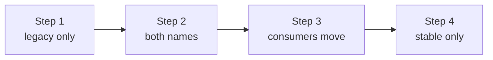

# Schema Versions And Compatibility For Consumers

Renaming attributes in the Collector makes producers consistent, and it can break consumers. A dashboard that was built on `http.method` shows nothing the day the name disappears. This part explains how telemetry schema versions describe changes, who is affected by a rename, and how to decide the order in which producers, the Collector and consumers change.

## Schema URLs and schema files

Every resource and scope in OTLP data can carry a schema URL. It names the version of the semantic conventions that the data follows, for example a URL that ends in `/schemas/1.21.0`. The URL points to a schema file, a small document that lists the changes between versions, such as renames of attributes. A tool that knows two versions can read the file and translate names from one to the other.

Two facts limit what this gives you:

- The schema URL is metadata. Nothing in the pipeline forces it to match the attribute names. A service can set an old URL and send new names.
- Translation only happens where something does it. The Collector has components for schema translation in some versions, and many backends do not apply schema files at all. Never assume that a consumer translates names on its own.

So the schema URL helps you find out which version a producer claims. It does not replace reading real spans.

## Who is affected by a rename

Four groups depend on attribute names:

| Group | Example | Effect of a removed name |
| --- | --- | --- |
| Dashboards | A panel that groups by `http.method` | Empty or partial panel. |
| Alerts | A rule on `http.status_code >= 500` | The alert stops firing. This is the most dangerous case, because nothing looks wrong. |
| Stored queries and reports | A saved search | Returns fewer results. |
| Downstream processing | A sampling policy or routing rule on an attribute | Policy no longer matches. |

An alert that silently stops firing is worse than a dashboard that shows nothing, since no one looks at an alert that is quiet by design. List the consumers of each name before a rename. A search through dashboard and alert definitions for the legacy name gives the list.

## Three ways to roll out a rename

**Big bang.** Rename in the Collector at once and update every consumer at the same time. It needs everything to change on one day. Any consumer that is missed breaks.

**Consumers first.** Update every consumer to query the stable name, then rename in the Collector. Consumers that query only the stable name show only part of the data until the rename is live, because producers still send legacy names. The gap closes when the rename goes live.

**Dual emission.** The Collector writes both names for a period. Old consumers keep working, new consumers can start to use the stable name, and nothing breaks at any step. After all consumers have moved, the legacy name is removed.



The diagram shows the stages of a dual emission window. The window is the period between steps 2 and 4.

Dual emission has costs. Each span carries two extra attributes, which increases size and storage. The two values must stay equal, which the rule guarantees only if it copies in both directions. The window must have an end date, or the legacy names stay forever.

## The OpenTelemetry HTTP migration as an example

The HTTP conventions provide an opt-in setting for this purpose: the environment variable `OTEL_SEMCONV_STABILITY_OPT_IN`. Its documented values include `http`, which emits only the stable names, and `http/dup`, which emits both the stable and the older names. Instrumentation that supports it lets a team start the dual emission at the producer instead of the Collector. Which libraries support the variable depends on the library and version, so check its documentation.

The pattern shows the same three stages: old only, both, new only. It gives you a model for your own rename of internal attributes.

## Decide the order for your case

Questions that give the order:

1. Which producers can change, and which cannot? A third-party service that sends a legacy name must be handled in the Collector.
2. Which consumers can move, and by when? If one consumer cannot move for months, the window must be long.
3. Can the Collector rule make both names from either side? Spans from new services only have the stable name, and old consumers still query the legacy one, so copying only legacy to stable is not enough in a window.
4. Who owns the end of the window, and how is it announced?

The third question is the key technical point and the subject of the next part.

## Inspect the current state in the playground

The playground Collector deletes the legacy names. Read its transform processor to see what consumers can query today:

<!-- astrona:playground:renew -->

```sh
kubectl -n observability get configmap otelcol-config -o jsonpath='{.data.config\.yaml}'
```

Answer these questions from the output:

1. Which statements delete a name?
2. If a consumer queries `http.method`, what does it see for a span from an old service?
3. What does it see for a span from a new service?

For both spans the consumer sees nothing, because the rule deletes the legacy name and the new service never sent it.

## Checkpoints

- A schema URL says `1.21.0` and the span has the stable names. Which is right?
- Which consumer is the most dangerous to break, and why?
- What is the end condition of a dual emission window?

Answers: the span, because the URL is metadata and the attribute names are the data. An alert, because a broken alert is quiet. Every consumer has moved to the stable name.

You can now decide who is affected by a rename and choose a rollout order. The next part builds the rule for a dual emission window.

## Common pitfalls

> [!WARNING]
> - Do not trust a schema URL as proof of the names in the data.
> - Do not assume a consumer translates names. Test it.
> - Do not rename without a list of dashboards and alerts that use the old name.
> - Do not open a dual emission window without an end date.
